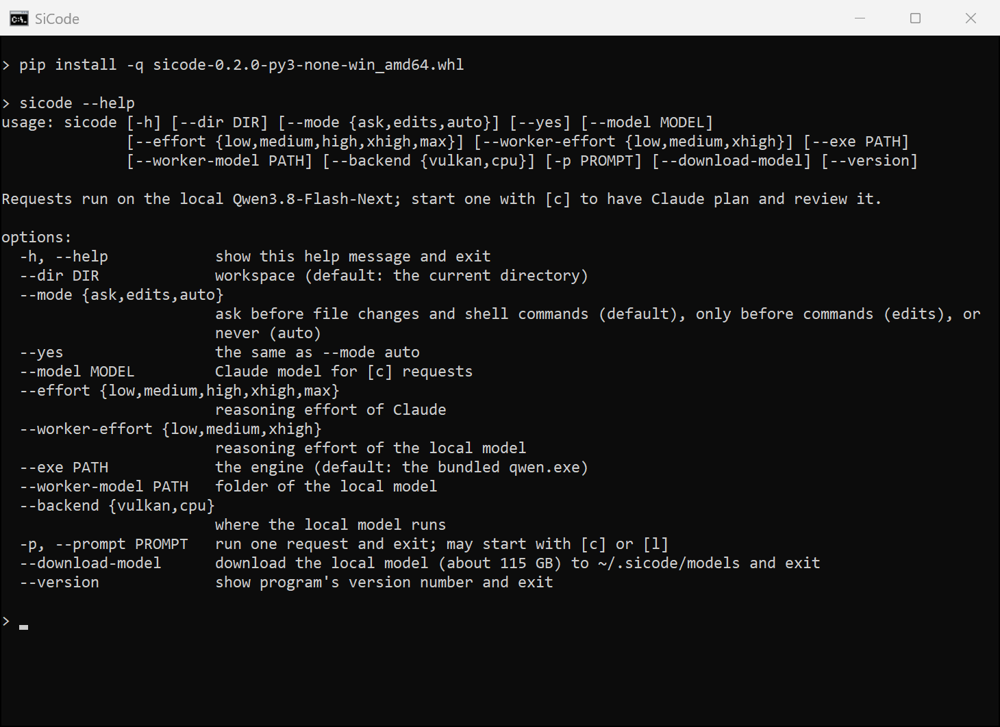

# qwen3-local-test

![SiCode in the browser: a Mix-mode task, with steps marked [l] for the local model and [c] for Claude](docs/sicode-mix.png)

From-scratch C++ inference engine for Qwen MoE models (CPU AVX-512 + hand-written Vulkan compute shaders, no ML libraries).

- **Qwen3.8-Flash-Next 128B** from Unsloth's 4-bit **UD-Q4_K_XL** GGUF (the default model and format). The GGUF is read
  in place: Q4_K / Q5_K / Q5_1 / Q8_0 / IQ4_NL blocks are decoded on the fly by the CPU kernels and the shaders.
- Qwen3.5 / 3.6 MoE models from FP8 safetensors.

## SiCode

A coding assistant for the terminal and the browser, built on this engine. Requests run on the local
Qwen3.8-Flash-Next; `[m]` (mix) has Claude or Codex split the job between itself and the local model, and `[c]` has
Claude or Codex do it alone. The cloud model signs in with your Claude or ChatGPT account (through Claude Code or
Codex) or with a Claude API key.

**Download:** [sicode-0.2.1-py3-none-win_amd64.whl](https://github.com/folgerwang/qwen3-local-test/releases/download/sicode-v0.2.1/sicode-0.2.1-py3-none-win_amd64.whl)
([all releases](https://github.com/folgerwang/qwen3-local-test/releases))

```
pip install sicode-0.2.1-py3-none-win_amd64.whl
sicode --download-model        # once: the local model, about 115 GB, to ~/.sicode/models
cd your-project
sicode                         # in the terminal
sicode --web                   # as a page in the browser (the screenshot above)
```



`sicode --web` opens the same assistant as a page in the browser: tasks, live progress, approvals and the files it
changed.

The wheel holds the assistant and a prebuilt engine (`qwen.exe`) for 64-bit Windows; nothing has to be compiled. It
needs Python 3.10 or later, a CPU with AVX-512, a GPU with a Vulkan 1.3 driver (`--backend cpu` runs without one,
slowly) and the Microsoft Visual C++ runtime. If `sicode` is not found after installing, pip put it in a folder that
is not on PATH; `python -m sicode` does the same. From a checkout of this repository, `pip install -e .` uses the
engine and the model from the Setup section below. Details: [sicode/README.md](sicode/README.md).

## Setup

Requires Visual Studio 2022, CMake ≥ 3.20, the Vulkan SDK and Python 3.

```
setup.bat                  # download Qwen3.8-Flash-Next UD-Q4_K_XL (~111 GB) + its MTP draft head (4 GB) and build
setup.bat --model 35b      # Qwen3.6-35B-A3B-FP8 (~35 GB)
setup.bat --model 122b     # Qwen3.5-122B-A10B-FP8 (~119 GB)
setup.bat --model all      # all models (flash, 35B, 122B, 27B)
setup.bat --model none     # build only
setup.bat --cpu-only       # build without the Vulkan backend
```

Weights go to `models/<name>/` (git-ignored). Re-running resumes/skips completed downloads.

## Run

```
chat.bat [cpu|vulkan]      # Qwen3.8-Flash-Next UD-Q4_K_XL
chat-35b.bat [cpu|vulkan]  # 35B (FP8)
chat-122b.bat              # 122B (FP8)
```

`qwen.exe --model PATH` takes a directory of `*.gguf` shards (or one `.gguf` file) or an FP8 safetensors model
directory. Any other GGUF quantization of Qwen3.8-Flash-Next works on the CPU backend as long as its tensors are
F32 / F16 / BF16 / Q8_0 / Q4_K / Q5_K / Q6_K / Q5_1 / IQ4_NL; the Vulkan backend needs the routed experts in
Q4_K, Q5_K, Q8_0 (gate/up) and additionally Q5_1 (down).

For the GGUF model the Vulkan backend is built for a machine with much more RAM than VRAM: the dense weights
(~5.5 GB) and a cache of the most used experts live in VRAM, and the
CPU computes every other expert straight from the memory-mapped GGUF (72 GB of experts, so plan for ~96 GB of RAM or
more). Each layer does one GPU round trip, so other programs using the GPU slow it down noticeably. `--threads N`
sets the CPU threads for the experts (default: one per core).

The expert cache takes the VRAM that is free on the card when the engine starts, less a 2 GB margin (on NVIDIA under
Windows, where the driver reports what all programs use; elsewhere 6 GB). `--expert-cache MB` caps it, 0 = none. It
never takes more than is free: an overcommitted card is much slower. Closing other programs that hold VRAM is the
easiest way to make the model faster. The K/V caches of the attention layers start at 16,384 tokens and double as
the conversation grows, so the 256K context limit costs no VRAM until it is used; when they grow, the VRAM comes out
of the expert cache.

Speculative decoding: with the model's MTP draft head (`mtp-*.gguf` one directory above the shards, where setup puts
it) the Vulkan backend drafts up to 3 tokens per pass (`--draft N`, 0 = off) and verifies them together. A drafted
token is kept only when it equals the token sampled from the model's own logits at that position, so the output is
the same as without drafting (identical with `--greedy`); the recurrent state is rolled back to a per-token snapshot
when a draft is rejected. Once the dense part is amortized this way, the speed is bound by how fast the CPU can
stream the non-cached experts from RAM, so a larger `--expert-cache` helps if VRAM is free.

## Tests

```
python tests/check_gguf.py tiny      # tiny random GGUF: CPU and Vulkan against HF transformers (needs transformers >= 5.8)
python tests/check_gguf.py models/Qwen3.8-Flash-Next-GGUF/UD-Q4_K_XL   # real model: Vulkan against CPU
python tests/check.py                # 35B FP8: compare logits against the fp32 reference
```
